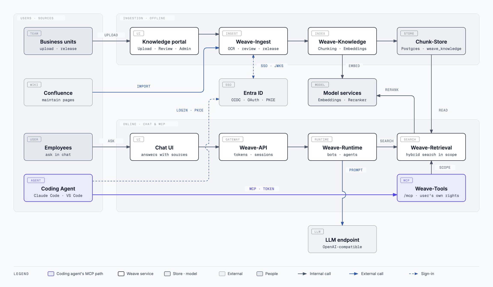

# Set up MCP with SSO (Entra ID)

*Deutsche Fassung: [[MCP-mit-SSO-einrichten]]*

This guide connects an MCP client — Claude Code, VS Code or a configuration
dialog such as Keyzapper — to Weave via single sign-on. Afterwards the client
searches with the signed-in user's account: it sees exactly the knowledge
spaces that person sees in the portal, nothing more.

The authoritative version with all background is
[docs/integrations/vscode-mcp-sso.md](https://github.com/bl0rb/Weave/blob/main/docs/integrations/vscode-mcp-sso.md)
(German). This page is the step-by-step version for Entra ID. For Keycloak
the same steps apply accordingly; the differences are in the docs.

## The big picture



Business units bring knowledge in through the knowledge portal or Confluence.
Employees ask in the chat. A coding agent signs in with Entra ID and calls
Weave-Tools via MCP; Weave-Tools searches through Weave-Retrieval only in the
knowledge spaces the signed-in person may see. Vector and HTML versions live
in the repository under
[docs/diagrams](https://github.com/bl0rb/Weave/tree/main/docs/diagrams).

## How sign-in works

1. The client calls `https://<weave-host>/mcp` without a token and receives
   `401` pointing to the discovery address.
2. At `/.well-known/oauth-protected-resource/mcp` it learns which identity
   provider to sign in with and which scope it needs.
3. It opens the browser login at Entra (authorization code with PKCE) and
   receives an access token for the Weave MCP API.
4. Weave checks signature, issuer, audience and scope and maps the token to an
   existing Weave user via the Entra object ID (`oid`).

Weave creates no users and takes no permissions from the token. Anyone who
doesn't exist in the portal or is deactivated gets no access via MCP either.

## Who does what

| Role | Part |
|---|---|
| Entra administrator | [Part 1](#part-1--set-up-entra-id) |
| Weave operator | [Part 2](#part-2--configure-weave) and [Part 3](#part-3--check-the-server-is-ready) |
| Every user | [Part 4](#part-4--set-up-the-client) and [Part 5](#part-5--first-sign-in) |

## Before you start: collect the values

These five values come up in every part. Note them once, then just fill them in.

| Placeholder | Where from | Example |
|---|---|---|
| `<tenant-id>` | Entra → Overview → Tenant ID | `00000000-…` |
| `<api-client-id>` | Application (client) ID of the API app from step 1 | `11111111-…` |
| `<public-client-id>` | Application (client) ID of the client app from step 5 | `22222222-…` |
| `<weave-host>` | Public host name under which `/mcp` is reachable | `weave.example.org` |
| `<port>` | Any free local port for the login callback | `8976` |

Client IDs are not secrets. A client secret is not needed anywhere and must
not be distributed.

---

## Part 1 — Set up Entra ID

You need **two** app registrations: one for the Weave MCP API (the resource)
and one for the MCP clients (the caller). The app registration the portal
signs in with is neither of them.

### The API app

**Step 1 — Register the app.** Entra → App registrations → New registration.
Name e.g. `weave-mcp-api`, accounts in this directory only, no redirect URI.
The Application (client) ID is `<api-client-id>`.

**Step 2 — Set the Application ID URI.** Expose an API → Application ID URI →
Add. Accept the suggestion `api://<api-client-id>`.

> **Common mistake:** **No** scope name goes here. If it says
> `api://<api-client-id>/mcp.read`, the scope later becomes
> `…/mcp.read/mcp.read`. The preview below the "Scope name" field shows this.

**Step 3 — Add the scope.** Expose an API → Add a scope:

| Field | Value |
|---|---|
| Scope name | `mcp.read` |
| Who can consent | `Admins only` (consent is then granted in step 7) |
| Admin consent display name | `Read Weave via MCP` |
| Admin consent description | `Allows the app to search Weave and read released knowledge via MCP on behalf of the signed-in user.` |
| State | `Enabled` |

The preview now shows `api://<api-client-id>/mcp.read`.

**Step 4 — Enforce token version 2.** Manifest → set
`requestedAccessTokenVersion` to `2` (under `api` in the new manifest editor),
save.

> Without this setting Entra issues v1 tokens with the issuer
> `https://sts.windows.net/<tenant-id>/`. Weave expects the v2 issuer and
> rejects every token — sign-in works, access doesn't.

### The client app

**Step 5 — Register the app.** New registration, name e.g. `weave-mcp-client`,
accounts in this directory only. The Application (client) ID is
`<public-client-id>`.

**Step 6 — Set up the redirect URI and public client.** Authentication → Add a
platform → **Mobile and desktop applications**:

- For Claude Code: `http://localhost:<port>/callback`
- For VS Code also `http://127.0.0.1:33418` and, if used in the browser,
  `https://vscode.dev/redirect` (platform "Web" for that one)

Below, set **Allow public client flows** to `Yes`. Don't create a client secret.

**Step 7 — Grant the permission.** API permissions → Add a permission →
My APIs → `weave-mcp-api` → Delegated → `mcp.read` → Add. Then click
**Grant admin consent for …**. The status must show a green "Granted".

---

## Part 2 — Configure Weave

**Step 8 — Check the portal's sign-in provider.** The portal must already sign
in via Entra (same tenant). Note this provider's slug from the administration;
it is needed as `MCP_OAUTH_PROVIDER_SLUG` in a moment.

**Step 9 — Set values in `weave.yaml`.** Under `services.tools.settings` and
`services.ingest.settings`, fill in `value` for each:

```text
# Tools
MCP_OAUTH_ISSUER        = https://login.microsoftonline.com/<tenant-id>/v2.0
MCP_OAUTH_RESOURCE_URL  = https://<weave-host>/mcp
MCP_OAUTH_SCOPES        = ["api://<api-client-id>/mcp.read"]

# Ingest
MCP_OAUTH_PROVIDER_SLUG    = <slug from step 8>
MCP_OAUTH_AUDIENCE         = <api-client-id>
MCP_OAUTH_SUBJECT_CLAIM    = oid
MCP_OAUTH_REQUIRED_SCOPES  = ["mcp.read"]
```

- The issuer is **tenant-specific**, never `common` or `organizations`.
- `MCP_OAUTH_AUDIENCE` is the bare GUID of the API app, without `api://`.
- `TOOLS_INTROSPECTION_TOKEN` must be identical in Ingest and Tools;
  `weave_config.py render` takes care of that.

For Helm, `python scripts/weave_config.py helm-values` carries the values into
`config.tools` and `config.ingest`.

**Step 10 — Expose the ingress.** Enable `ingress.toolsMcp` in the Helm chart.
Whether on its own host or the portal's host — what matters is that these
paths reach the MCP service and not the portal:

- `/mcp`
- `/.well-known/oauth-protected-resource` (also covers `…/mcp`)

On a **dedicated host** the default `path: /` is enough. If MCP shares the host
with the portal, `/` belongs to the portal; then list only the two paths above:

```yaml
ingress:
  toolsMcp:
    enabled: true
    hosts:
      - host: <weave-host>
        paths:
          - path: /mcp
            pathType: Prefix
          - path: /.well-known/oauth-protected-resource
            pathType: Prefix
    tls: [...]   # as for the other ingresses
```

Then roll out.

---

## Part 3 — Check the server is ready

**Step 11 — Fetch discovery.**

```bash
curl -i https://<weave-host>/.well-known/oauth-protected-resource/mcp
```

Expected: `200` with JSON containing `"resource": "https://<weave-host>/mcp"`
and the Entra issuer under `authorization_servers`.

**Step 12 — Call MCP without a token.**

```bash
curl -i https://<weave-host>/mcp
```

Expected: `401` with a `WWW-Authenticate` header naming `resource_metadata`
and the scope.

If either returns an HTML page or a `404` from the portal, the routing from
step 10 is missing. Only continue with part 4 once both calls look right.

---

## Part 4 — Set up the client

### Claude Code via a dialog (e.g. Keyzapper)

| Field | Value |
|---|---|
| Name | `weave` |
| Type | `HTTP` |
| URL | `https://<weave-host>/mcp` — **with** `/mcp` |
| Header | leave empty |
| Client ID | `<public-client-id>` |
| Callback port | `<port>` — the same as in step 6 |
| Scopes | `api://<api-client-id>/mcp.read` |

Save. The dialog writes the project-local `.mcp.json`; it contains no secrets,
Claude Code manages the tokens itself.

### Claude Code from the command line

```bash
claude mcp add --transport http --scope project --client-id <public-client-id> --callback-port <port> weave https://<weave-host>/mcp
```

You don't need to pass the scope here; the server names it in its `401`
response.

### VS Code

The project file `.vscode/mcp.json` in the repository is already prepared.
Change the URL to `https://<weave-host>/mcp`; VS Code asks for the client ID
on start. Details in the
[docs](https://github.com/bl0rb/Weave/blob/main/docs/integrations/vscode-mcp-sso.md#vs-code-konfigurieren).

---

## Part 5 — First sign-in

**Step 13 — Sign in to the portal via Entra once.** Only then does Weave store
the account's Entra object ID. Skip it, and you can sign in to Entra via MCP,
but Weave won't recognise you.

**Step 14 — Sign in from the client.**

- Claude Code: `/mcp` → `weave` → **Authenticate**, sign in to Entra in the
  browser.
- VS Code: `MCP: List Servers` → `weave` → **Start**, browser login.

The server then shows "connected", and the tools `list_collections` and
`search` are available.

---

## Troubleshooting

| What you see | Cause | Fix |
|---|---|---|
| Client reports "Failed", browser shows a portal 404 page | URL without `/mcp`, or the paths reach the portal | Check the URL, step 10 |
| `421 Misdirected Request` | Host doesn't match `MCP_OAUTH_RESOURCE_URL` | Correct the host in the resource URL or add it to `MCP_ALLOWED_HOSTS` |
| `503 service misconfigured` | Resource URL or `TOOLS_INTROSPECTION_TOKEN` missing | Step 9, roll out again |
| `AADSTS50011` (redirect URI mismatch) | Port in the client ≠ registered redirect URI | Align the port and step 6 |
| `AADSTS65001` (consent required) | Admin consent missing | Step 7 |
| `AADSTS7000218` (client_secret required) | Public client flows off | Step 6, "Allow public client flows" |
| `AADSTS9010010` (resource does not match scope) | Entra rejects the resource `https://<weave-host>/mcp` sent along | Try setting the API app's Application ID URI to `https://<weave-host>/mcp` and adjust the scopes accordingly |
| Sign-in works, then always `401` | v1 token, wrong issuer or wrong audience | Step 4 and step 9 (`v2.0`, bare GUID) |
| `403 insufficient_scope` | Token without `mcp.read` | Scope in the client (part 4) and step 7 |
| `401` although everything looks right | User unknown, deactivated or never signed in to the portal via Entra | Step 13 |

## See also

- [docs/integrations/vscode-mcp-sso.md](https://github.com/bl0rb/Weave/blob/main/docs/integrations/vscode-mcp-sso.md) — authoritative version, also for Keycloak (German)
- [[Rechte-und-Sichtbarkeit]], section "MCP mit eigener Anmeldung (SSO)" (German)
- [[Betrieb]] (German)
