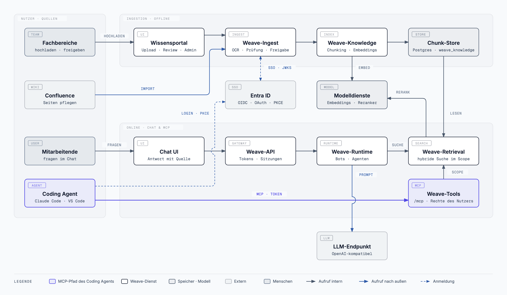

# MCP mit SSO einrichten (Entra ID)

*English version: [[MCP-SSO-Setup]]*

Diese Anleitung verbindet einen MCP-Client — Claude Code, VS Code oder ein
Konfigurationsdialog wie Keyzapper — per Single Sign-on mit Weave. Danach
sucht der Client mit dem Konto des angemeldeten Nutzers: Er sieht genau die
Wissensbereiche, die diese Person auch im Portal sieht, nicht mehr.

Die maßgebliche Fassung mit allen Hintergründen ist
[docs/integrations/vscode-mcp-sso.md](https://github.com/bl0rb/Weave/blob/main/docs/integrations/vscode-mcp-sso.md).
Diese Seite ist die Schritt-für-Schritt-Fassung für Entra ID. Für Keycloak
gelten dieselben Schritte sinngemäß; die Unterschiede stehen in der Doku.

## Gesamtbild



Fachbereiche bringen Wissen über das Wissensportal oder Confluence ein.
Mitarbeitende fragen im Chat. Ein Coding Agent meldet sich bei Entra ID an und
ruft Weave-Tools per MCP auf; Weave-Tools sucht über Weave-Retrieval nur in den
Wissensbereichen, die die angemeldete Person sehen darf. Vektorgrafik und
HTML-Fassung liegen im Repository unter
[docs/diagrams](https://github.com/bl0rb/Weave/tree/main/docs/diagrams).

## So funktioniert die Anmeldung

1. Der Client ruft `https://<weave-host>/mcp` ohne Token auf und bekommt
   `401` mit einem Verweis auf die Discovery-Adresse.
2. Unter `/.well-known/oauth-protected-resource/mcp` erfährt er, bei welchem
   Identity Provider er sich anmelden muss und welchen Scope er braucht.
3. Er öffnet den Browser-Login bei Entra (Authorization Code mit PKCE) und
   erhält ein Access Token für die Weave-MCP-API.
4. Weave prüft Signatur, Issuer, Audience und Scope und ordnet das Token über
   die Entra-Objekt-ID (`oid`) einem vorhandenen Weave-Nutzer zu.

Weave legt dabei keine Nutzer an und übernimmt keine Rechte aus dem Token.
Wer im Portal nicht existiert oder deaktiviert ist, bekommt auch per MCP
keinen Zugriff.

## Wer macht was

| Rolle | Teil |
|---|---|
| Entra-Administrator | [Teil 1](#teil-1--entra-id-einrichten) |
| Betreiber von Weave | [Teil 2](#teil-2--weave-konfigurieren) und [Teil 3](#teil-3--prüfen-ob-der-server-bereit-ist) |
| Jeder Nutzer | [Teil 4](#teil-4--client-einrichten) und [Teil 5](#teil-5--erste-anmeldung) |

## Vorab: Werte sammeln

Diese fünf Werte tauchen in allen Teilen wieder auf. Am besten einmal
notieren und dann nur noch einsetzen.

| Platzhalter | Woher | Beispiel |
|---|---|---|
| `<tenant-id>` | Entra → Übersicht → Mandanten-ID | `00000000-…` |
| `<api-client-id>` | Application (client) ID der API-App aus Schritt 1 | `11111111-…` |
| `<public-client-id>` | Application (client) ID der Client-App aus Schritt 5 | `22222222-…` |
| `<weave-host>` | Öffentlicher Hostname, unter dem `/mcp` erreichbar ist | `weave.example.org` |
| `<port>` | Frei wählbarer lokaler Port für den Login-Rückruf | `8976` |

Client-IDs sind keine Geheimnisse. Ein Client-Secret wird an keiner Stelle
gebraucht und darf auch nicht verteilt werden.

---

## Teil 1 — Entra ID einrichten

Es werden **zwei** App-Registrierungen gebraucht: eine für die Weave-MCP-API
(die Ressource) und eine für die MCP-Clients (den Aufrufer). Die
App-Registrierung, mit der sich das Portal anmeldet, ist keine von beiden.

### Die API-App

**Schritt 1 — App registrieren.** Entra → App registrations → New
registration. Name zum Beispiel `weave-mcp-api`, nur Konten dieses
Verzeichnisses, keine Redirect-URI. Die Application (client) ID ist
`<api-client-id>`.

**Schritt 2 — Application ID URI setzen.** Expose an API → Application ID URI
→ Add. Den Vorschlag `api://<api-client-id>` übernehmen.

> **Häufiger Fehler:** Hier gehört **kein** Scope-Name hinein. Steht dort
> `api://<api-client-id>/mcp.read`, heißt der Scope später
> `…/mcp.read/mcp.read`. Die Vorschau unter dem Feld „Scope name“ zeigt das.

**Schritt 3 — Scope anlegen.** Expose an API → Add a scope:

| Feld | Wert |
|---|---|
| Scope name | `mcp.read` |
| Who can consent | `Admins only` (Zustimmung dann in Schritt 7) |
| Admin consent display name | `Weave über MCP lesen` |
| Admin consent description | `Erlaubt der App, im Namen des angemeldeten Nutzers über MCP in Weave zu suchen und freigegebenes Wissen zu lesen.` |
| State | `Enabled` |

Die Vorschau zeigt jetzt `api://<api-client-id>/mcp.read`.

**Schritt 4 — Token-Version 2 erzwingen.** Manifest →
`requestedAccessTokenVersion` auf `2` setzen (im neuen Manifest-Editor unter
`api`), speichern.

> Ohne diese Einstellung stellt Entra v1-Tokens mit dem Issuer
> `https://sts.windows.net/<tenant-id>/` aus. Weave erwartet den v2-Issuer und
> weist jedes Token ab — der Login klappt, der Zugriff nicht.

### Die Client-App

**Schritt 5 — App registrieren.** New registration, Name zum Beispiel
`weave-mcp-client`, nur Konten dieses Verzeichnisses. Die Application (client)
ID ist `<public-client-id>`.

**Schritt 6 — Redirect-URI und öffentlichen Client einrichten.**
Authentication → Add a platform → **Mobile and desktop applications**:

- Für Claude Code: `http://localhost:<port>/callback`
- Für VS Code zusätzlich `http://127.0.0.1:33418` und, falls im Browser
  genutzt, `https://vscode.dev/redirect` (dafür Plattform „Web“)

Darunter **Allow public client flows** auf `Yes` stellen. Kein Client-Secret
anlegen.

**Schritt 7 — Berechtigung erteilen.** API permissions → Add a permission →
My APIs → `weave-mcp-api` → Delegated → `mcp.read` → Add. Danach
**Grant admin consent for …** klicken. Der Status muss grün „Granted“ zeigen.

---

## Teil 2 — Weave konfigurieren

**Schritt 8 — Anmeldeverfahren im Portal prüfen.** Das Portal muss bereits
über Entra (gleicher Tenant) anmelden. Den Slug dieses Anbieters aus der
Administration notieren, er wird gleich als `MCP_OAUTH_PROVIDER_SLUG` gebraucht.

**Schritt 9 — Werte in `weave.yaml` setzen.** Unter
`services.tools.settings` und `services.ingest.settings` jeweils `value`
eintragen:

```text
# Tools
MCP_OAUTH_ISSUER        = https://login.microsoftonline.com/<tenant-id>/v2.0
MCP_OAUTH_RESOURCE_URL  = https://<weave-host>/mcp
MCP_OAUTH_SCOPES        = ["api://<api-client-id>/mcp.read"]

# Ingest
MCP_OAUTH_PROVIDER_SLUG    = <slug aus Schritt 8>
MCP_OAUTH_AUDIENCE         = <api-client-id>
MCP_OAUTH_SUBJECT_CLAIM    = oid
MCP_OAUTH_REQUIRED_SCOPES  = ["mcp.read"]
```

- Der Issuer ist **tenant-spezifisch**, nie `common` oder `organizations`.
- `MCP_OAUTH_AUDIENCE` ist die nackte GUID der API-App, ohne `api://`.
- `TOOLS_INTROSPECTION_TOKEN` muss in Ingest und Tools identisch sein; das
  erledigt `weave_config.py render` von selbst.

Für Helm werden die Werte mit `python scripts/weave_config.py helm-values`
nach `config.tools` und `config.ingest` übertragen.

**Schritt 10 — Ingress freischalten.** Im Helm-Chart `ingress.toolsMcp`
einschalten. Ob ein eigener Host oder der Portal-Host — entscheidend ist, dass
diese Pfade beim MCP-Dienst landen und nicht beim Portal:

- `/mcp`
- `/.well-known/oauth-protected-resource` (deckt auch `…/mcp` ab)

Auf einem **eigenen Host** genügt die Vorgabe `path: /`. Teilt sich MCP den
Host mit dem Portal, gehört `/` dem Portal; dann nur die beiden Pfade oben
eintragen:

```yaml
ingress:
  toolsMcp:
    enabled: true
    hosts:
      - host: <weave-host>
        paths:
          - path: /mcp
            pathType: Prefix
          - path: /.well-known/oauth-protected-resource
            pathType: Prefix
    tls: [...]   # wie bei den anderen Ingresses
```

Danach ausrollen.

---

## Teil 3 — Prüfen, ob der Server bereit ist

**Schritt 11 — Discovery abrufen.**

```bash
curl -i https://<weave-host>/.well-known/oauth-protected-resource/mcp
```

Erwartet: `200` mit JSON, darin `"resource": "https://<weave-host>/mcp"` und
der Entra-Issuer unter `authorization_servers`.

**Schritt 12 — MCP ohne Token aufrufen.**

```bash
curl -i https://<weave-host>/mcp
```

Erwartet: `401` mit einem `WWW-Authenticate`-Header, der `resource_metadata`
und den Scope nennt.

Kommt bei einem der beiden eine HTML-Seite oder ein `404` des Portals zurück,
fehlt die Weiterleitung aus Schritt 10. Erst wenn beide Aufrufe stimmen, lohnt
sich Teil 4.

---

## Teil 4 — Client einrichten

### Claude Code über einen Dialog (z. B. Keyzapper)

| Feld | Wert |
|---|---|
| Name | `weave` |
| Art | `HTTP` |
| URL | `https://<weave-host>/mcp` — **mit** `/mcp` |
| Header | leer lassen |
| Client-ID | `<public-client-id>` |
| Callback-Port | `<port>` — derselbe wie in Schritt 6 |
| Scopes | `api://<api-client-id>/mcp.read` |

Speichern. Der Dialog schreibt die projektlokale `.mcp.json`; sie enthält
keine Geheimnisse, Tokens verwaltet Claude Code selbst.

### Claude Code über die Kommandozeile

```bash
claude mcp add --transport http --scope project --client-id <public-client-id> --callback-port <port> weave https://<weave-host>/mcp
```

Den Scope muss man hier nicht angeben, der Server nennt ihn in seiner
`401`-Antwort.

### VS Code

Die Projektdatei `.vscode/mcp.json` im Repository ist bereits vorbereitet. Die
URL auf `https://<weave-host>/mcp` ändern; die Client-ID fragt VS Code beim
Start ab. Details in der
[Doku](https://github.com/bl0rb/Weave/blob/main/docs/integrations/vscode-mcp-sso.md#vs-code-konfigurieren).

---

## Teil 5 — Erste Anmeldung

**Schritt 13 — Einmal im Portal über Entra anmelden.** Nur dabei speichert
Weave die Entra-Objekt-ID des Kontos. Wer das auslässt, kann sich per MCP zwar
bei Entra anmelden, wird von Weave aber nicht erkannt.

**Schritt 14 — Im Client anmelden.**

- Claude Code: `/mcp` → `weave` → **Authenticate**, im Browser bei Entra
  anmelden.
- VS Code: `MCP: List Servers` → `weave` → **Start**, Browser-Login.

Danach steht der Server auf „connected“, und die Werkzeuge `list_collections`
und `search` sind verfügbar.

---

## Wenn es nicht klappt

| Was man sieht | Ursache | Lösung |
|---|---|---|
| Client meldet „Failed“, im Browser kommt eine 404-Seite des Portals | URL ohne `/mcp` oder Pfade landen beim Portal | URL prüfen, Schritt 10 |
| `421 Misdirected Request` | Host stimmt nicht mit `MCP_OAUTH_RESOURCE_URL` überein | Host in der Resource-URL korrigieren oder in `MCP_ALLOWED_HOSTS` ergänzen |
| `503 service misconfigured` | Resource-URL oder `TOOLS_INTROSPECTION_TOKEN` fehlt | Schritt 9, neu ausrollen |
| `AADSTS50011` (Redirect URI mismatch) | Port im Client ≠ registrierte Redirect-URI | Port und Schritt 6 angleichen |
| `AADSTS65001` (consent required) | Admin-Zustimmung fehlt | Schritt 7 |
| `AADSTS7000218` (client_secret required) | Public client flows aus | Schritt 6, „Allow public client flows“ |
| `AADSTS9010010` (resource does not match scope) | Entra lehnt die mitgesendete Ressource `https://<weave-host>/mcp` ab | Application ID URI der API-App testweise auf `https://<weave-host>/mcp` setzen und Scopes entsprechend anpassen |
| Login klappt, danach immer `401` | v1-Token, falscher Issuer oder falsche Audience | Schritt 4 und Schritt 9 (`v2.0`, nackte GUID) |
| `403 insufficient_scope` | Token ohne `mcp.read` | Scope im Client (Teil 4) und Schritt 7 |
| `401`, obwohl alles stimmt | Nutzer unbekannt, deaktiviert oder nie über Entra im Portal angemeldet | Schritt 13 |

## Siehe auch

- [docs/integrations/vscode-mcp-sso.md](https://github.com/bl0rb/Weave/blob/main/docs/integrations/vscode-mcp-sso.md) — maßgebliche Fassung, auch für Keycloak
- [[Rechte-und-Sichtbarkeit]], Abschnitt „MCP mit eigener Anmeldung (SSO)“
- [[Betrieb]]
